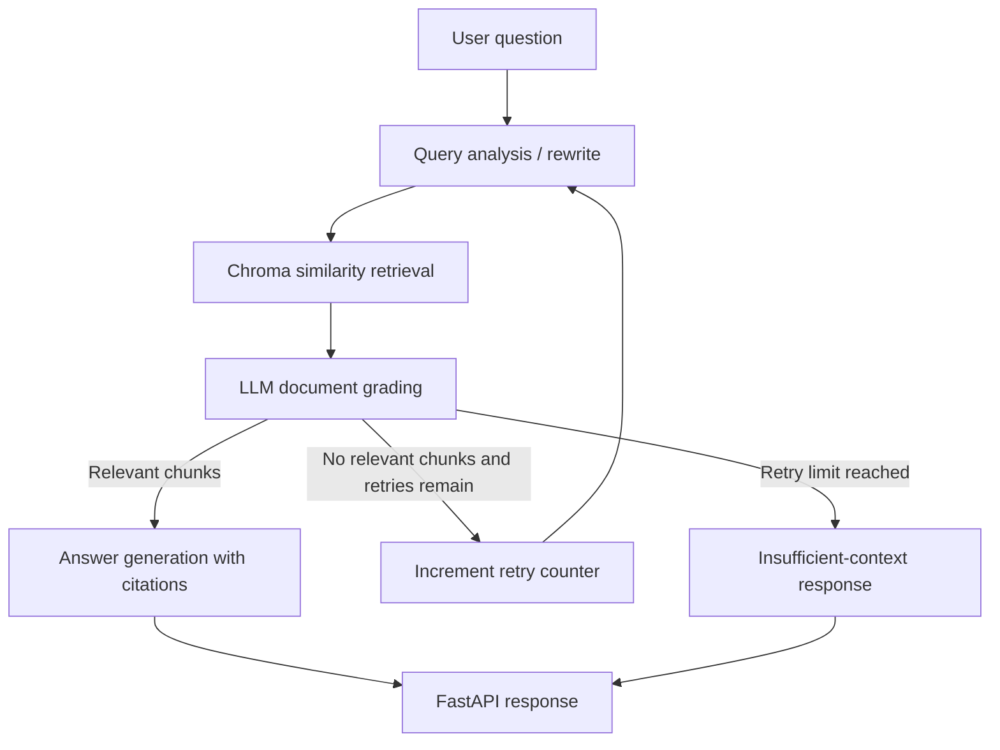

# Technical Documentation Assistant — Self-Corrective RAG

**Express Analytics | AI/ML Engineer Intern Take-Home Assignment**

A retrieval-augmented technical documentation assistant built with Python, FastAPI, LangGraph, ChromaDB, and OpenAI. It indexes PDF/TXT/Markdown files or HTML URLs, retrieves relevant passages, grades their relevance, retries retrieval after query rewriting, and generates grounded answers with source citations.

## 1. Features

- File ingestion: PDF, TXT, MD, Markdown.
- URL ingestion: fetches HTML pages and extracts readable text.
- Recursive chunking with configurable chunk size and overlap.
- Gemini embeddings stored in persistent ChromaDB.
- LangGraph workflow with query analysis, retrieval, document grading, generation, and bounded retry/fallback.
- Answers cite source documents using `[1]`, `[2]` references and return structured source metadata.
- FastAPI endpoints: `/query`, `/ingest`, `/documents`, `/feedback`.
- Input validation, upload-size limits, basic error handling, and health endpoint.

## 2. Architecture



**State fields:** `question`, `rewritten_query`, `documents`, `relevant_documents`, `retries`, `max_retries`, `answer`, `sources`, and `status`.

## 3. Project structure

```text
express_analytics_rag_assistant/
├── app/
│   ├── config.py
│   ├── graph.py
│   ├── ingestion.py
│   ├── main.py
│   ├── schemas.py
│   └── vectorstore.py
├── data/
│   └── sample_docs/       # Four starter technical documents
├── scripts/
│   └── ingest_sample_docs.py
├── tests/
├── .env.example
├── .gitignore
├── requirements.txt
└── README.md
```

## 4. Setup (Windows PowerShell)

Use Python 3.11 or 3.12.

```powershell
# 1. Open this folder in VS Code
# 2. Create a virtual environment
py -3.11 -m venv .venv
.venv\Scripts\Activate.ps1

# 3. Install dependencies
python -m pip install --upgrade pip
pip install -r requirements.txt

# 4. Create your local environment file
Copy-Item .env.example .env
```

Open `.env` and replace `your_api_key_here` with your own OpenAI API key. Do not commit `.env` or share your key. The Gemini API has a free tier for selected models, subject to quotas and terms. Check your AI Studio usage limits before running the project.

For macOS/Linux, activate with `source .venv/bin/activate` and copy `.env.example` to `.env`.

## 5. Run the application

In the project root, with the virtual environment active:

```bash
python -m scripts.ingest_sample_docs
uvicorn app.main:app --reload
```

Open `http://127.0.0.1:8000/docs` for interactive Swagger API documentation. The first ingestion and query calls use the configured Gemini embedding/chat models.

## 6. API examples

### Query

```bash
curl -X POST "http://127.0.0.1:8000/query" ^
  -H "Content-Type: application/json" ^
  -d "{\"question\":\"How does LangGraph route to a retry node?\"}"
```

Example response shape:

```json
{
  "answer": "A conditional edge can inspect the retry counter and choose the rewrite path while retries remain [1].",
  "sources": [
    {
      "citation": "[1]",
      "source": "langgraph_basics.md",
      "source_type": "file"
    }
  ],
  "retries": 0,
  "status": "answered"
}
```

The exact answer and sources depend on the indexed corpus and model output.

### Ingest local files

Use Swagger UI at `/docs`, choose `POST /ingest`, upload one or more PDF/TXT/MD files, and execute. The endpoint also accepts a `urls` query parameter as a list.

### Ingest URLs

```bash
curl -X POST "http://127.0.0.1:8000/ingest?urls=https://fastapi.tiangolo.com/" 
```

### List documents

```bash
curl "http://127.0.0.1:8000/documents"
```

### Feedback

```bash
curl -X POST "http://127.0.0.1:8000/feedback" ^
  -H "Content-Type: application/json" ^
  -d "{\"question\":\"What is FastAPI?\",\"answer\":\"FastAPI is a Python web framework.\",\"rating\":\"up\",\"comment\":\"Helpful\"}"
```

Feedback is appended to `data/feedback.jsonl` and is not currently used to retrain or alter retrieval.

## 7. Design decisions and trade-offs

- **ChromaDB:** chosen for a simple persistent local vector store with metadata support; a managed vector database could be introduced for production scale.
- **Google Gemini embeddings and chat model:** one provider keeps setup straightforward. The embedding model must remain consistent between indexing and querying.
- **RecursiveCharacterTextSplitter:** uses 900-character chunks and 150-character overlap by default. Separators prioritize headings and paragraph boundaries before smaller text boundaries. This is a practical baseline for mixed technical prose; code-aware parsing could improve chunk quality.
- **Top-k retrieval:** retrieves six candidate chunks by default. Larger k can improve recall but may increase grading cost and context noise.
- **LLM document grading:** grades each candidate independently as YES/NO. It improves precision but adds latency and model cost.
- **Bounded retry:** one rewrite/retrieval retry by default prevents infinite loops. If no passage is judged relevant, the system returns an explicit insufficient-context answer rather than fabricating one.
- **Grounded generation:** the generation prompt restricts answers to retrieved context and asks for numbered citations. Citations identify source documents; they are not yet page/line-level citations.
- **URL ingestion:** extracts visible text from HTML pages. JavaScript-rendered sites, PDFs hosted behind complex login flows, and sites that block automated requests may need a dedicated loader.

## 8. Assumptions and limitations

- The user supplies a valid Google Gemini API key and has API access/billing enabled for the selected models.
- URL ingestion is intended for publicly accessible HTML pages.
- PDF ingestion extracts text; scanned/image-only PDFs require OCR, which is not included.
- This is an internship take-home prototype, not a production-hardened service. Authentication, rate limiting, SSRF protections, observability, background ingestion jobs, and deployment configuration should be added before public production use.
- The starter corpus is provided to make the project testable immediately. Add the official documentation URLs/files you want the assistant to cover and mention them in your submission.

## 9. Suggested improvements

1. Add reranking and hybrid keyword/vector retrieval.
2. Add answer-groundedness verification as a separate LangGraph node.
3. Add conversation memory with explicit session persistence.
4. Add OCR for scanned PDFs and code-aware chunking.
5. Add authentication, rate limits, safe URL allow-listing, and automated tests.
6. Add evaluation questions and measure retrieval recall, answer faithfulness, and latency.

## 10. Submission checklist

- [ ] Add your API key to local `.env` (never upload it).
- [ ] Install dependencies successfully.
- [ ] Run sample ingestion and confirm `/documents` lists four documents.
- [ ] Ask at least three questions whose answers are in the corpus.
- [ ] Ask one unrelated question and confirm the system returns an insufficient-context response.
- [ ] Test file and URL ingestion.
- [ ] Check that answers include citations and source metadata.
- [ ] Commit the project, README, and sample corpus to GitHub.
- [ ] Do not commit `.env`, `chroma_db/`, or private data.
- [ ] Be prepared to explain the graph nodes, retry counter, chunking, embeddings, and trade-offs.

## 11. Suggested evaluation questions

1. What is a LangGraph StateGraph?
2. How does FastAPI validate a request body?
3. What does top-k similarity search return?
4. Why is chunk overlap used?
5. What happens when all retrieved documents are graded irrelevant?
